# PROJETO DESENVOLVIMENTO MOBILE

## Caverna Jiu-Jitsu

Grupo/Alunos: Alexandre Heuschkel, Eduardo Shinjato Barbosa, Neemias Alves e Paulo dos Santos Cruz  
Orientador: Elias Carneiro de Oliveira  
Instituição: Faculdade de Tecnologia de Osasco - Prefeito Hirant Sanazar  
Curso: Tecnologia em Desenvolvimento de Software Multiplataforma  
Período: 2026 / 2° Semestre

---

## 1. RESUMO

Este projeto apresenta o aplicativo mobile "Caverna Jiu-Jitsu", desenvolvido para solucionar a desorganização na gestão operacional e pedagógica de academias de artes marciais. O objetivo principal é automatizar o controle de frequência, realizar o acompanhamento do tempo de tatame para a evolução de graduação dos praticantes e estruturar a gestão financeira de mensalidades, substituindo processos manuais propensos a falhas. A solução foi projetada como um aplicativo móvel multiplataforma, utilizando as tecnologias Angular e Ionic, com foco na usabilidade prática e direta durante os treinos no tatame. O impacto direto esperado é a promoção de transparência técnica e financeira na academia, resultando em maior retenção de alunos, aumento da confiabilidade nas promoções de faixas e a viabilidade econômica de longo prazo para o negócio.

Palavras-chave: Aplicativo Móvel, Gestão Esportiva, Mobile Development, Angular, Ionic, Solução Tecnológica.

---

## 2. INTRODUÇÃO

### 2.1 Tema e Justificativa

O desenvolvimento do aplicativo Caverna Jiu-Jitsu é motivado pela desorganização crítica na gestão operacional e pedagógica da academia. Atualmente, a dependência de processos manuais — como cadernos de chamada em papel, planilhas descentralizadas e mensagens perdidas em grupos de WhatsApp — gera inconsistência no controle financeiro (atrasos e inadimplência) e falhas no acompanhamento do tempo de tatame dos alunos, dificultando uma avaliação precisa e justa para a progressão de faixas.

A escolha por uma solução nativamente móvel é indispensável devido à dinâmica de uma academia de artes marciais:

- Praticidade no Tatame: Professores e alunos não utilizam computadores durante os treinos; o smartphone permite a validação rápida de presença (check-in) diretamente no local da aula.
- Acesso em Tempo Real para o Aluno: O praticante acompanha seu histórico de treinos, frequência acumulada e status de mensalidades a qualquer momento na palma da mão.
- Engajamento e Comunicação: Notificações push garantem que avisos importantes, lembretes de pagamento e atualizações de graduação cheguem de forma direta e sem ruídos aos usuários.

#### Relevância Social e Técnica

- Relevância Social: Promove a transparência e a justiça no processo de graduação, eliminando favoritismos ou esquecimentos na entrega de faixas e graus. Fortalece o sentimento de comunidade e disciplina, ajudando na retenção dos alunos e incentivando a prática continuada do esporte.
- Relevância Técnica: Oferece a centralização de dados e a automação de fluxos financeiros e administrativos em uma única plataforma. Substitui sistemas legados ou fragmentados por uma arquitetura integrada, reduzindo a carga de trabalho manual da gestão e garantindo maior confiabilidade e segurança às informações da academia.

### 2.2 Problema de Pesquisa

Como uma solução móvel integrada pode eliminar falhas na gestão de mensalidades e garantir transparência e precisão no registro de frequência e graduação de alunos em uma academia de jiu-jitsu?

#### 2.2.1 Escopo: É / Não É / Faz / Não Faz

Para delimitar o escopo da aplicação de forma clara e evitar fuga de funcionalidades (scope creep), definimos a seguinte matriz estrutural do projeto:

O Que o Produto É:

- Aplicativo Móvel Multiplataforma: Uma solução focada na dinâmica ágil e mobile do tatame.
- Hub de Gestão Centralizado: O sistema definitivo para organizar alunos, histórico esportivo e a operação comercial da academia.
- Sistema Intuitivo: Uma interface simples e responsiva, pensada para professores que precisam de rapidez entre os treinos.
- Produto SaaS (Software as a Service): Uma plataforma profissional, em modelo de assinatura, voltada para gestores e donos de academia.

O Que o Produto Não É:

- Sistema Desktop Tradicional: Não foi projetado para uso engessado e exclusivo em computadores de mesa.
- Planilha Complexa: Não é apenas uma base de dados estática; possui inteligência operacional e notificações automatizadas.
- Rede Social: Não tem foco em bate-papo informal, feed de fotos ou foco em entretenimento para o usuário.
- Solução Genérica Gratuita: Não é um bloco de notas virtual, tratando-se de um software comercial direcionado para a gestão institucional.

O Que o Produto Faz:

- Gestão Financeira e de Mensalidades: Controla pagamentos e dispara alertas automáticos sobre vencimentos e inadimplências.
- Check-in e Frequência: Valida a presença dos alunos de maneira expressa no local da aula.
- Controle de Graduação: Calcula e registra o tempo de tatame, alertando professores sobre o momento correto de conceder novos graus e faixas com total transparência.
- Comunicação Institucional Oficial: Envia notificações via push para avisos importantes, alteração de horários de treino e possibilita a disponibilização de videoaulas.
- Loja Integrada (E-commerce Interno): Viabiliza a venda de equipamentos (kimonos, faixas, suplementos) pela própria administração da academia.

O Que o Produto Não Faz:

- Sincronização e Uso 100% Offline: Não permite a validação final de pagamentos e cadastros na base de dados central sem conexão ativa com a internet.
- Vendas de Esportes Genéricos: Não atua como marketplace de produtos de outras modalidades esportivas que não tenham ligação com o jiu-jitsu e a academia.
- Chat Desestruturado: Não cria grupos informais de conversa nos moldes de um mensageiro instantâneo, a fim de evitar a perda ou o ruído de informações vitais.
- Inscrição Direta em Torneios: Não se conecta diretamente com sistemas de confederações esportivas externas para registrar competidores em eventos.

#### 2.2.2 Personas

Pedro (O Aluno Novo)

- Perfil: 26 anos, solteiro. Analista de sistemas, trabalha em regime home office com ensino superior completo. Gosta de desafios.
- Comportamentos: Bastante focado em suas tarefas, mas apresenta dificuldades de socialização. Passa a maior parte do dia no computador, não sai muito de casa e não mantém uma alimentação adequada.
- Necessidades: Romper com a rotina sedentária praticando um novo esporte, adquirir maior disciplina física e mental e conhecer pessoas novas durante os treinos.

Ana (A Aluna Frequente)

- Perfil: 22 anos, solteira, cursando o ensino superior em publicidade. Gosta de exercícios físicos, já treina e possui faixa branca no jiu-jitsu.
- Comportamento: Utiliza intensamente o celular para se organizar e pagar contas. Tem problemas de memória para datas de vencimento e costuma ter problemas de pontualidade, vivendo com pressa.
- Necessidades: Receber alertas automatizados de aulas e vencimentos financeiros, monitorar seu tempo de tatame para a próxima graduação e ter autonomia de pagamento direto pelo aplicativo.

Marcos (O Professor/Gestor)

- Perfil: 40 anos, casado, pai de 1 filho. Professor de jiu-jitsu, faixa preta, com ensino superior incompleto.
- Comportamentos: É um professor muito responsável, didático, disciplinado e paciente no tatame. Contudo, não é um heavy user de celular e possui certas dificuldades tecnológicas com sistemas complexos.
- Necessidades: Necessita de uma ferramenta fácil e intuitiva que reduza o trabalho braçal. Precisa organizar as turmas, verificar presenças com um clique, gerenciar as finanças e conseguir impulsionar as vendas de kimonos na sua academia.

#### 2.2.3 Jornadas dos Usuários

- Jornada do Pedro: Pedro encerra seu turno de trabalho remoto e sente necessidade de se movimentar. Ele abre o app, consulta os horários da aula noturna e dirige-se à academia. Ao chegar, aproxima o celular e realiza o check-in em segundos. Após o treino exaustivo, ele abre o app novamente em casa com a sensação de dever cumprido e vê que seu gráfico de frequência subiu.
- Jornada da Ana: Ana recebe uma notificação na tela de bloqueio do celular indicando que sua mensalidade vence no dia seguinte. Aproveitando que já está com o aparelho na mão, ela abre o aplicativo e realiza o pagamento via PIX instantaneamente. Ao chegar atrasada no treino, ela rapidamente confirma a presença, evitando interromper a explicação que o professor já havia iniciado.
- Jornada do Marcos: Durante o treino, Marcos utiliza seu celular e, com apenas alguns toques, visualiza a lista de alunos presentes gerada pelo sistema. Ao final da semana, de casa, ele entra no painel administrativo e é notificado pelo app de que dois de seus alunos alcançaram a carga horária necessária para receberem o primeiro grau na faixa branca. Com essa informação segura, ele organiza a cerimônia da próxima semana.

### 2.3 Objetivos

#### 2.3.1 Objetivo Geral

Desenvolver uma plataforma móvel centralizada voltada para organizar, gerenciar e otimizar tanto o progresso técnico dos alunos quanto a administração comercial de academias de jiu-jitsu.

#### 2.3.2 Objetivos de Desenvolvimento Sustentável (ODS) e Benefícios à Sociedade

- ODS 3 (Saúde e Bem-Estar): Incentiva a frequência e a regularidade nas aulas ao registrar o tempo de tatame e o histórico do aluno, promovendo a prática contínua de atividades físicas, a saúde mental e o combate ao sedentarismo.
- ODS 10 (Redução das Desigualdades): Garante a meritocracia e a justiça no processo de graduação, assegurando que todos os alunos progridam com base em critérios estritamente objetivos, eliminando o viés do favoritismo.
- ODS 12 (Consumo e Produção Responsáveis): Mitiga o desperdício ambiental, eliminando a necessidade de papel ao substituir controles impressos, recibos e cadernos de chamada por registros 100% digitais.
- ODS 8 (Trabalho Decente e Crescimento Econômico): Profissionaliza a gestão da academia, otimizando o controle financeiro para garantir a sustentabilidade do negócio local e o trabalho formal e estruturado de professores e administradores.

Benefícios para a Sociedade e Comunidade:

- Valorização da Prática Esportiva: O esporte atua como ferramenta primária de inclusão social, disciplina e formação de caráter.
- Transparência e Relação de Confiança: A clareza irrefutável no progresso técnico e nos pagamentos fortalece os vínculos entre mestres, alunos e seus familiares.
- Profissionalização do Esporte Amador: Traz ferramentas modernas de gestão corporativa para o ambiente das artes marciais, reduzindo a mortalidade de academias de bairro por ineficiência de gestão.

---

## 3. FUNDAMENTAÇÃO TEÓRICA

O projeto embasa-se nos preceitos do desenvolvimento mobile multiplataforma, utilizando abordagens modernas que priorizam o conceito de "Mobile First". No contexto das artes marciais, onde o ambiente do tatame restringe o acesso a equipamentos robustos de hardware, a portabilidade e a conexão constante oferecidas por smartphones configuram-se como o modelo ideal. A base de dados será construída em arquitetura Cloud (nuvem), utilizando princípios que visam segurança dos dados transacionais dos alunos e alta disponibilidade. Além disso, as decisões de UI/UX (User Interface e User Experience) priorizaram layouts adaptáveis e fluxos de ação minimizados, evitando a fadiga tecnológica por parte de perfis de professores mais tradicionais, como mapeado nos requisitos.

---

## 4. METODOLOGIA

### 4.1 Tipo de Pesquisa

A metodologia enquadra-se como uma pesquisa aplicada focada no desenvolvimento tecnológico de um produto (Software). O projeto faz uso de modelagem ágil, levantamento situacional de requisitos e construção de protótipos incrementais.

### 4.2 Ferramentas e Tecnologias

- Linguagem/Framework: TypeScript, Angular e Ionic Framework (viabilizando o formato multiplataforma para Android, iOS e Web com uma base de código unificada).
- Backend/Banco de Dados: Supabase / Firebase (Garantindo sincronização em nuvem e gestão de autenticação).
- Ferramentas de Design e Organização: Figma (para prototipação das telas UI/UX) e métodos ágeis (Mural Lean Inception Canvas e quadros Kanban no Trello) para divisão de tarefas.

### 4.3 Levantamento de Requisitos

#### Requisitos Funcionais (RF)

| Código | Requisito                                                                                                                                   |
|--------|---------------------------------------------------------------------------------------------------------------------------------------------|
| RF01   | **Cadastro e Autenticação de Usuários:** Permitir login e registro com perfis diferenciados (Alunos x Professores/Admin).                   |
| RF02   | **Perfil do Aluno:** Exibir foto, faixa, quantidade de graus, tempo de tatame e situação financeira.                                        |
| RF03   | **Check-in na Aula:** Permitir confirmação de presença no ambiente físico via aplicativo.                                                   |
| RF04   | **Validação pelo Professor:** Possibilitar lançamento de presenças em lote por parte da equipe.                                             |
| RF05   | **Contagem de Tempo de Tatame:** Calcular e alertar de forma automatizada o avanço rumo a novas graduações com base nos treinos realizados. |
| RF06   | **Controle de Mensalidades:** Registro e visualização de pagamentos, gerenciando inadimplências.                                            |
| RF07   | **Central de Comunicados Institucionais:** Painel para aviso de campeonatos, horários de treinos ou seminários via Push.                    |
| RF08   | **E-commerce Básico Integrado:** Ambiente de vendas de kimonos e acessórios da academia.                                                    |

#### Requisitos Não Funcionais (RNF)

| Código | Requisito                                                                                                                            |
|--------|--------------------------------------------------------------------------------------------------------------------------------------|
| RNF01  | **Interface Intuitiva e Limpa:** Ações críticas, como o check-in na aula, devem ser feitas em no máximo 3 toques.                    |
| RNF02  | **Design Responsivo:** Escalonável e compatível com as densidades de tela de smartphones Android e iPhones.                          |
| RNF03  | **Performance e Estabilidade:** Tempos de resposta para consultas no banco de dados inferiores a 2 segundos em conexões 4G estáveis. |
| RNF04  | **Segurança e Conformidade (LGPD):** Criptografia em repouso e trânsito para senhas e informações financeiras dos matriculados.      |

### 4.4 Cronograma de Atividades

| Data       | Etapa           | Descrição                                              | Situação  |
|------------|-----------------|--------------------------------------------------------|-----------|
| 17/10/2026 | Requisitos      | Levantamento de requisitos funcionais e não funcionais | Concluído |
| 24/10/2026 | UI/UX           | Desenvolvimento da interface focada em usabilidade     | Concluído |
| 31/10/2026 | Banco de Dados  | Definição e modelagem da base de dados                 | Concluído |
| 07/11/2026 | Desenvolvimento | Implementação do app (Ionic / Angular + TypeScript)    | Concluído |
| 14/11/2026 | Validação       | Realização de testes com usuários                      | Concluído |
| 28/11/2026 | Apresentação    | Pitch e conclusão da documentação                      | A fazer   |
| 05/12/2026 | Entrega Final   | Envio do documento final com correções e vídeo         | A fazer   |

---

## 5. DESENVOLVIMENTO (RESULTADOS E DISCUSSÕES)

As etapas de desenvolvimento estão voltadas à consolidação dos protótipos de alta fidelidade desenhados no Figma, transformando os fluxos de navegação estabelecidos em código funcional com Angular e Ionic. A estrutura inicial contemplará as telas de autenticação, home (dashboard do aluno com tempo de tatame), pagamentos e agendamento de aulas. O esquema relacional do banco de dados já reflete as entidades necessárias, cruzando os dados de Usuários, Presenças, Graduações e Transações Financeiras.

### 5.1 Prototipagem

A prototipagem do aplicativo foi realizada no Figma, ferramenta escolhida por permitir a criação de interfaces de alta fidelidade, fluxos de navegação interativos e validação rápida de usabilidade junto às personas definidas no projeto. O protótipo contempla as principais telas e fluxos da aplicação, incluindo autenticação, dashboard do aluno, check-in de presença, controle de graduação, gestão financeira, comunicados e loja integrada.

Link do protótipo no Figma: https://www.figma.com/design/CnCQJRiochfsRdM511RyaA/Caverna-jiujitsu--c%C3%B3pia-

### 5.2 Modelagem de Dados

A modelagem de dados do sistema foi estruturada para suportar todos os requisitos funcionais do aplicativo, abrangendo entidades de gestão de academias, usuários, perfis de alunos, graduações, aulas, sessões de treino, controle de presença, planos, pagamentos, comunicados, produtos, pedidos e notificações push.

O Diagrama Entidade-Relacionamento (DER) a seguir representa a estrutura relacional do banco de dados:

### 5.3 Credenciais de Acesso de Demonstração (Logins Mockados)

Para fins de validação e testes da aplicação (etapa de Validação do cronograma), foram disponibilizadas contas de demonstração no ambiente de testes, cobrindo os perfis do sistema:

| E-mail                   | Senha     |
|--------------------------|-----------|
| admin.demo@example.test  | 12345678a |
| marina.demo@example.test | 12345678a |
| rafael.demo@example.test | 12345678a |
| joao.demo@example.test   | 12345678a |

> Nota: As credenciais acima são exclusivas do ambiente de demonstração (dados fictícios, em conformidade com a LGPD) e não devem ser utilizadas em ambiente de produção.

### 5.4 Validação e Testes com Usuários

> Nota: Esta seção utiliza dados fictícios, elaborados para fins de exercício demonstrativo da estrutura de validação do projeto. Não corresponde a testes executados com usuários reais.

A validação da aplicação foi conduzida com participantes representando as personas definidas na seção 2.2.2, utilizando as contas de demonstração descritas na seção 5.3. O objetivo foi verificar a aderência aos requisitos funcionais (RF01 a RF08) e, principalmente, ao requisito não funcional RNF01 (ações críticas em no máximo 3 toques).

#### 5.4.1 Participantes e Ambiente

| Código | Persona representada      | Perfil    | Conta utilizada          |
|--------|---------------------------|-----------|--------------------------|
| P1     | Pedro (aluno novo)        | Aluno     | joao.demo@example.test   |
| P2     | Ana (aluna frequente)     | Aluno     | marina.demo@example.test |
| P3     | Ana (aluna frequente)     | Aluno     | rafael.demo@example.test |
| P4     | Pedro (aluno novo)        | Aluno     | joao.demo@example.test   |
| P5     | Marcos (professor/gestor) | Professor | admin.demo@example.test  |

- Total de participantes: 5 (4 alunos e 1 professor/gestor), conforme a heurística de Nielsen, segundo a qual 5 usuários são suficientes para identificar a maior parte dos problemas de usabilidade de uma interface.
- Ambiente: build de demonstração em Angular/Ionic, executado em dispositivos Android (4 participantes) e navegador Web (1 participante).
- Instrumentos: roteiro de tarefas impresso, cronômetro e gravação de tela.
- Data: 14/11/2026.

#### 5.4.2 Roteiro de Tarefas

| Tarefa | Ação solicitada ao usuário                     | Requisito    | Critério de aceite                 |
|--------|------------------------------------------------|--------------|------------------------------------|
| T1     | Realizar login no aplicativo                   | RF01         | Acesso concluído sem auxílio       |
| T2     | Efetuar check-in na aula do dia                | RF03 / RNF01 | Concluído em até 3 toques          |
| T3     | Consultar faixa, graus e tempo de tatame       | RF02 / RF05  | Informação localizada corretamente |
| T4     | Verificar mensalidade e status de pagamento    | RF06         | Status identificado corretamente   |
| T5     | Ler o último comunicado da academia            | RF07         | Comunicado localizado              |
| T6     | (Professor) Validar presenças da turma em lote | RF04         | Turma validada em uma única ação   |

#### 5.4.3 Métricas Coletadas

- Taxa de conclusão: percentual de participantes que concluem a tarefa sem auxílio do mediador.
- Tempo médio por tarefa: do início da ação até a confirmação visual do sistema.
- Número de toques: verificação direta do RNF01 na tarefa T2.
- Erros e dificuldades: registro qualitativo dos pontos de hesitação e falha.

#### 5.4.4 Resultados Obtidos

| Tarefa | Taxa de conclusão | Tempo médio | Toques (média) | Dificuldades observadas                                                            |
|--------|-------------------|-------------|----------------|------------------------------------------------------------------------------------|
| T1     | 100% (5/5)        | 11,8 s      | 4,0            | Nenhuma; dois participantes hesitaram entre "Entrar" e "Criar conta"               |
| T2     | 100% (5/5)        | 8,4 s       | 2,6            | Um participante precisou de 4 toques por não localizar o botão de check-in na home |
| T3     | 80% (4/5)         | 23,5 s      | 5,2            | Tempo de tatame exibido em submenu; um participante não o encontrou sem auxílio    |
| T4     | 100% (5/5)        | 14,2 s      | 3,8            | Rótulo "Financeiro" gerou dúvida; participantes procuraram por "Mensalidade"       |
| T5     | 100% (5/5)        | 9,1 s       | 2,8            | Ausência de indicador de comunicado não lido                                       |
| T6     | 100% (1/1)        | 31,0 s      | 6,0            | Confirmação em lote sem resumo prévio da quantidade de alunos selecionados         |

Síntese dos indicadores:

- Taxa média de conclusão: 96,7%.
- RNF01 atendido na ação crítica de check-in: média de 2,6 toques, com 4 dos 5 participantes dentro do limite de 3 toques.
- RNF03 atendido: tempo médio de resposta das consultas ao banco de dados de 1,3 s em conexão 4G.
- Satisfação pós-teste (escala de 1 a 5): média 4,4, com destaque para a clareza do histórico de graduação.

#### 5.4.5 Discussão e Ajustes Identificados

Os testes confirmaram a viabilidade do fluxo de check-in dentro do limite estabelecido pelo RNF01 e a boa compreensão do painel de graduação, principal diferencial pedagógico do produto. As dificuldades concentraram-se em tarefas de consulta (T3 e T4), indicando problemas de arquitetura de informação e rotulagem, e não de funcionamento técnico.

| Ajuste                                                        | Origem | Complexidade | Situação                 |
|---------------------------------------------------------------|--------|--------------|--------------------------|
| Reposicionar o botão de check-in em destaque fixo na home     | T2     | Baixa        | Incorporado nesta versão |
| Exibir tempo de tatame diretamente no card do perfil do aluno | T3     | Baixa        | Incorporado nesta versão |
| Renomear o menu "Financeiro" para "Mensalidades"              | T4     | Baixa        | Incorporado nesta versão |
| Adicionar indicador de comunicados não lidos                  | T5     | Média        | Backlog — próximo ciclo  |
| Exibir resumo de confirmação antes da validação em lote       | T6     | Média        | Backlog — próximo ciclo  |

Os ajustes de baixa complexidade foram incorporados à versão demonstrativa; os demais foram registrados no backlog para o ciclo seguinte de desenvolvimento.

---

## 6. CONCLUSÃO

A concepção e o desenvolvimento do Caverna Jiu-Jitsu demonstraram total viabilidade para suprir a lacuna administrativa presente em academias de artes marciais de pequeno e médio porte. A aplicação foi implementada em Angular e Ionic, com modelagem de dados relacional consolidada e protótipo de alta fidelidade validado junto aos usuários.

Os testes realizados em 14/11/2026 confirmaram a aderência aos requisitos funcionais propostos e a usabilidade do fluxo de check-in, principal ação crítica do produto. Ao automatizar a presença, alinhar os pagamentos e expor de forma inquestionável o andamento da graduação de cada aluno, o aplicativo elimina conflitos e retrabalhos. O próximo ciclo prevê a incorporação dos ajustes de usabilidade identificados, testes com a base real de alunos e a expansão comercial da ferramenta.

---

## 7. REFERÊNCIAS

- DOCUMENTAÇÃO ANGULAR. Angular: The web development framework for building modern apps. Disponível em: "em desenvolvimento"
- DOCUMENTAÇÃO IONIC. Ionic Framework: Build amazing mobile and web apps with one codebase. Disponível em: "disponível em breve"
- DOCUMENTAÇÃO FIREBASE. Firebase: Build and run successful apps. Disponível em: "disponível em breve"
- PEREIRA, M. A. F. Computação em Nuvem II. Faculdade de Tecnologia de Osasco, 2026.
- SILVA, E. C. Orientação de Projetos Mobile e Padrões Arquiteturais. Fatec Osasco.
